# Assignment 01: Git, Gitea, GitHub, Git LFS, and GitHub Pages

**Course:** Cloud Computing (SE-665)
**Department:** Software Engineering, Fatima Jinnah Women University
**Submitted by:** Wania Zainab
**Registration number:** FA24B1-SE-017
**Submitted to:** Engr. Waqas Saleem
**Date:** 10 October 2026

## Overview

In this assignment I installed Gitea on my Ubuntu server, created a Git repository on the same server, and pushed it to both Gitea and GitHub. I then tracked three large files with Git LFS and published a portfolio with GitHub Pages.

## Links

| Item | Link |
|------|------|
| GitHub repository (Assignment01) | https://github.com/waniazainab/Assignment01 |
| Portfolio repository | https://github.com/waniazainab/waniazainab.github.io |
| Live portfolio (GitHub Pages) | https://waniazainab.github.io/ |
| Gitea repository (local server) | http://192.168.204.129:3000/waniazainab/Assignment01 |

The Gitea link works only inside my lab network, because the server uses a private address.

## Task 1: Install Gitea and Push a Repository from the Ubuntu Server

- Installed Docker and the Docker Compose plug-in on the Ubuntu server.
- Cloned the instructor's Gitea setup repository and started Gitea and PostgreSQL with `docker compose up -d`.
- Completed the Gitea installation page and created my account.
- Created an empty public repository named `Assignment01` in Gitea.
- Created a local repository on the server with a `README.md` that holds my name and registration number.
- Added the `gitea` remote without a token in the address and pushed the `main` branch. The token was entered only at the password prompt.

**Step 1.1: Gitea and PostgreSQL running, with HTTP status 200**

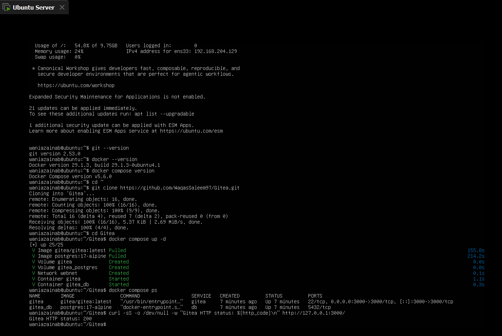

**Step 1.2: Push to the gitea remote**

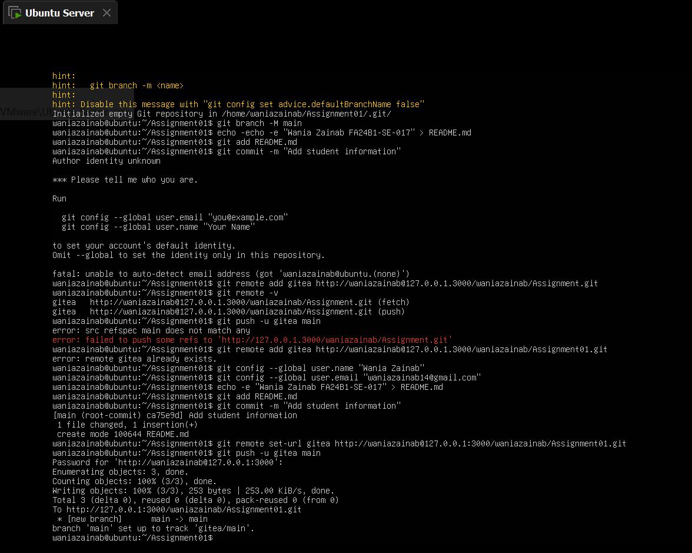

**Step 1.3: Repository in Gitea**

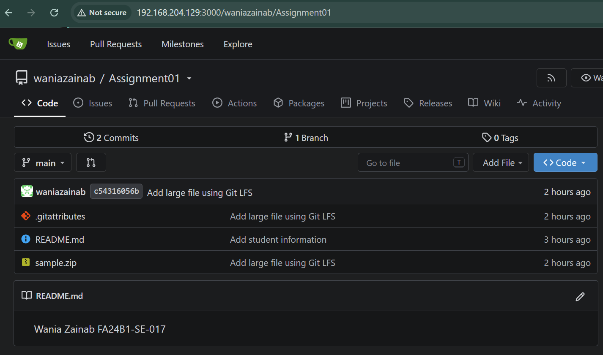

## Task 2: Push the Same Repository to GitHub

- Created an empty public repository named `Assignment01` on GitHub.
- Added the `github` remote to the same local repository, so it now has two remotes: `gitea` and `github`.
- Pushed the `main` branch to GitHub.

**Step 2.1: Both remotes**

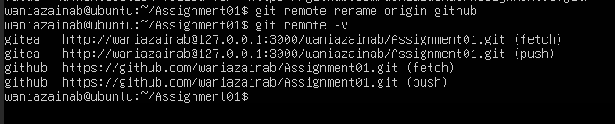

**Step 2.2: Push to the github remote**

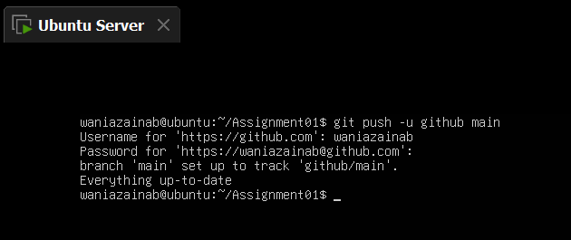

**Step 2.3: Repository on GitHub**

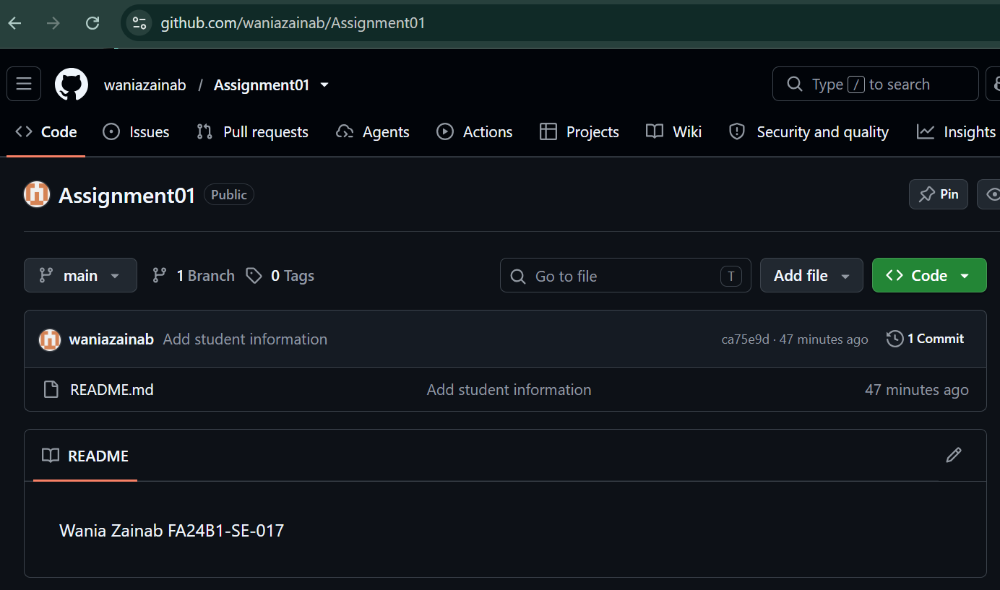

## Task 3: Track Three Large Files with Git LFS

- Ran `git lfs install` and tracked `*.bin` files with `git lfs track "*.bin"`.
- Created three files larger than 100 MiB: `large-file-1.bin`, `large-file-2.bin` and `large-file-3.bin`.
- Checked them with `git lfs ls-files --size`.
- Committed the files and pushed them to the `github` remote. The LFS upload finished at 100% (3/3).

**Step 3.1: Git LFS setup**

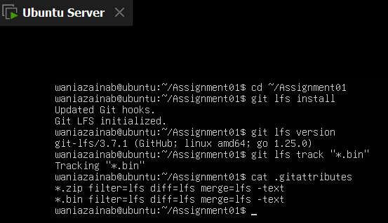

**Step 3.2: Three LFS files**

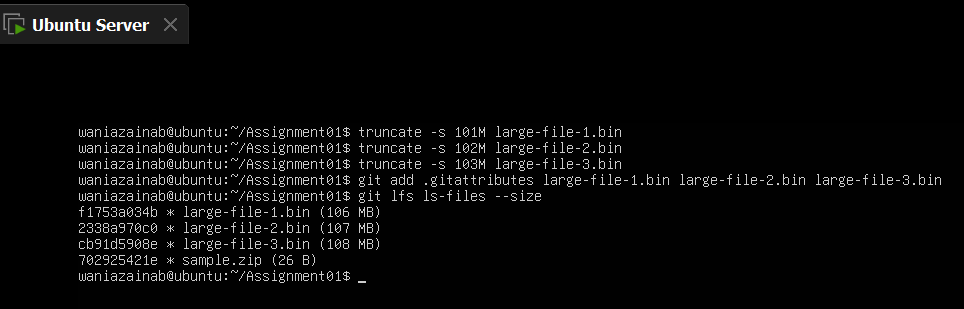

**Step 3.3: Commit and push**

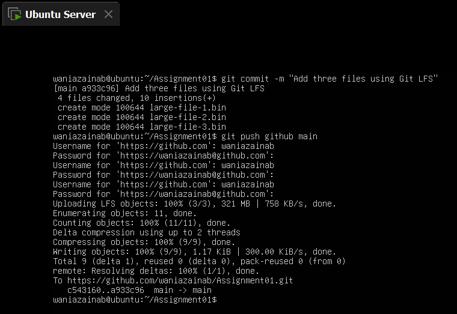

## Task 4: Create a Portfolio or CV with GitHub Pages

- Created the public repository `waniazainab.github.io`.
- Built the portfolio with `index.html` and `styles.css`. It has the sections About Me, Education, Skills and Projects.
- Turned on GitHub Pages from the `main` branch and the root folder.
- The site is live at https://waniazainab.github.io/.

**Step 4.1: Portfolio repository**

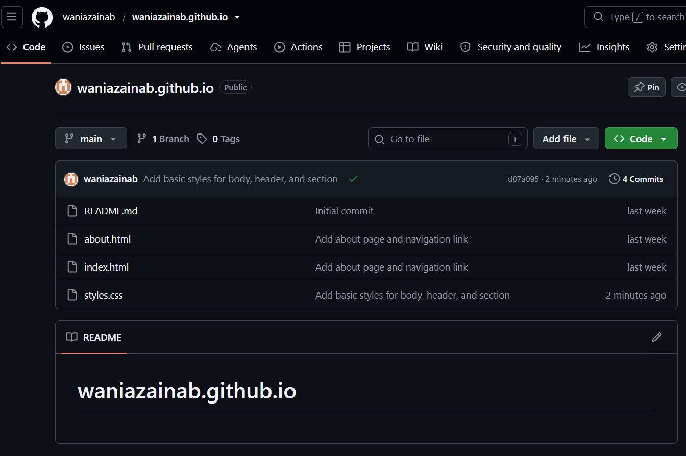

**Step 4.2: GitHub Pages deployment**

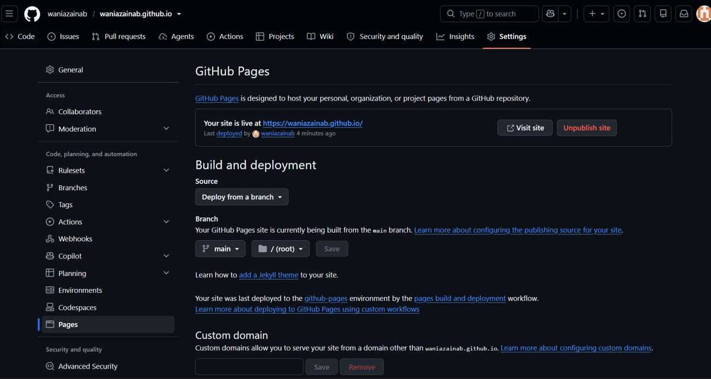

**Step 4.3: Live portfolio**

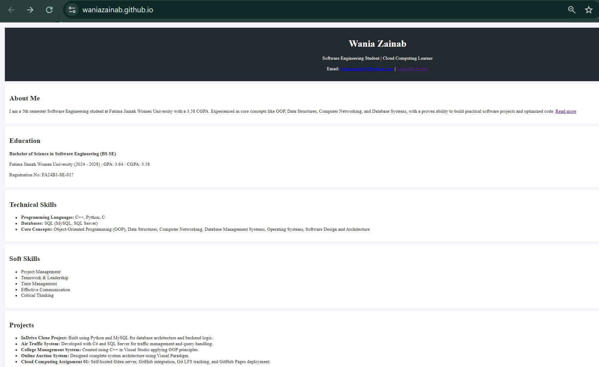

## Files in This Folder

```
Assignments/
└── Assignment01/
    ├── Assignment01.md
    ├── Assignment01_Solution.docx
    ├── Assignment01_Solution.pdf
    └── screenshots/
        ├── task1_gitea_running.png
        ├── task1_gitea_push.png
        ├── task1_gitea_repository.png
        ├── task2_remotes.png
        ├── task2_github_push.png
        ├── task2_github_repository.png
        ├── task3_lfs_setup.png
        ├── task3_lfs_files.png
        ├── task3_lfs_push.png
        ├── task4_pages_repository.png
        ├── task4_pages_deployment.png
        └── task4_portfolio_live.png
```
